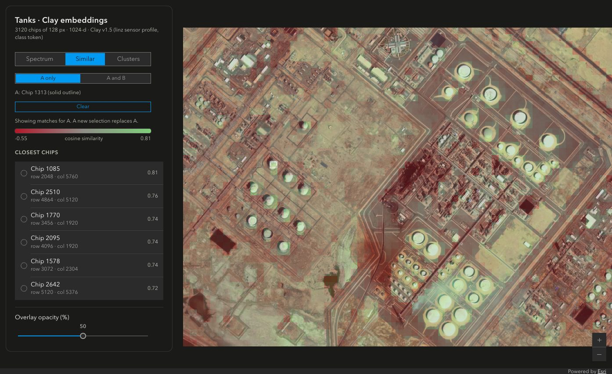
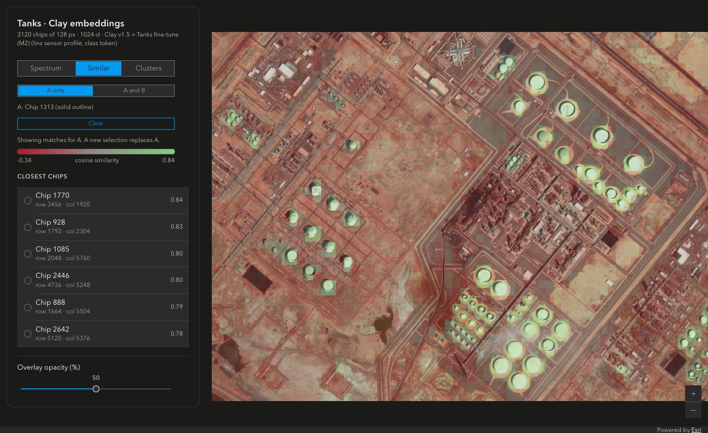
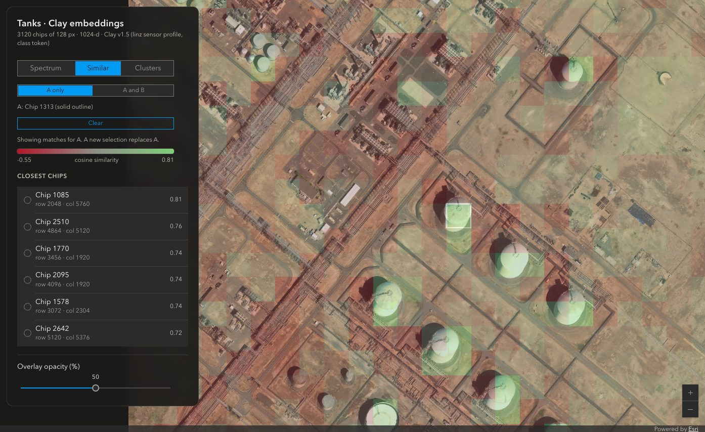
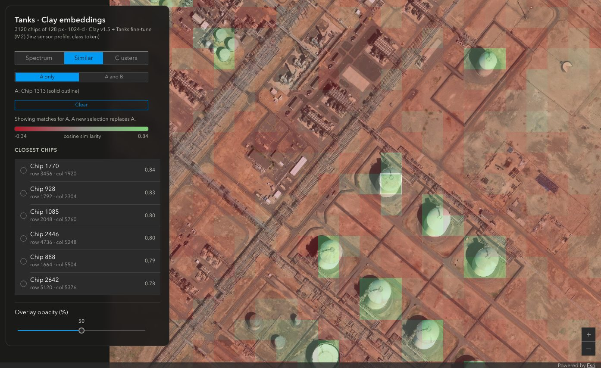

# Clay Embedding Explorer

This app shows [Clay v1.5](https://github.com/Clay-foundation/model) chip embeddings of an aerial GeoTIFF on a map.
It is a single-page VanillaJS app on ArcGIS Maps SDK for JavaScript 5.1 (CDN, no build step).

The app has three views over the source imagery:

- **Spectrum**: Shows the first three PCA components of each chip embedding as RGB. Similar colours show similar embeddings.
- **Similar**: Select **A only** (default) for one-click similarity. Select **A and B** for two-click vector operations: A + B, A − B, or the element-wise product A × B. The app colours chips by cosine similarity on a red → grey → green ramp (red = least similar, green = most similar). A list shows the closest matches. The ramp changes from dark red to light green, so red-green colour-blind viewers can read the order by lightness.
- **Clusters**: Shows k-means (k = 2–8) or DBSCAN (5 eps presets). `export_data.py` calculates both. Select an entry in the cluster list to show only that cluster, or only the DBSCAN noise.

In **A only**, each selection on the map or in the match list replaces A. The similarity updates immediately.

In **A and B**, the first selection sets A and the second selection sets B. The results show only after both
selections. A has a solid outline. B has a dashed outline. Later selections replace B. **Swap A/B** reverses the
subtraction. **Clear** removes both selections. A change of input mode also removes both selections.

The operations use the scene-centred, unit-length chip embeddings. The app normalizes the result before cosine
scoring. The match list does not include A or B. A zero-length result shows a message instead of scores. Vector
algebra is exploratory. The model does not guarantee that an operation agrees with a specific visual concept.

Move the pointer over a control row to show its help button. Select the question-mark button to open help.
Keyboard focus also shows help buttons. Touch screens show help buttons without hover.
The popup explains the selected view,
input mode, vector operation, or cluster method. Each numbered step contains one action.

## Example: Similar on storage tanks

These screenshots show **Similar** in **A only** mode on `Tanks.tif` (8,200 × 6,087 px, 0.5 m, 128 px chips,
3,120 chips). A is chip 1313, which contains a storage tank (solid white outline). The left column uses base
Clay v1.5. The right column uses the M2 tank encoder (refer to [Fine-tuned encoders](#fine-tuned-encoders)).
The overlay opacity is 50%. The top row shows the full image. The bottom row zooms in on chip 1313.

| Base Clay v1.5 | Tanks fine-tune (M2) |
|---|---|
|  |  |
|  |  |

P@6 is the fraction of the 6 closest chips that contain a tank. A chip contains a tank when the centroid of a
hand-drawn tank polygon (`Tanks.gdb`, layer `Tanks`) is in the chip. The labels are complete only inside the
`Extent` polygon, so the scores rank only chips with a centroid inside it. All 12 matches in the screenshots are
inside it. A "partial" chip has part of a tank but not its centroid. The strict score counts a partial chip as
a miss. The second score removes partial chips from the ranking, as the fine-tune test does.

| P@6 | Base Clay v1.5 | M2 |
|---|---:|---:|
| Chip 1313, strict | 0.50 | 0.33 |
| Chip 1313, partial chips removed | 1.00 | 1.00 |
| 78 tank chips (128 px), strict mean | 0.54 | 0.60 |
| 78 tank chips (128 px), partial chips removed, mean | 0.77 | 0.91 |
| 84 tank chips (64 px), strict mean | 0.35 | 0.38 |
| 84 tank chips (64 px), partial chips removed, mean | 0.68 | 0.84 |

- Most strict misses are partial chips. In the screenshots, all 12 matches touch a tank: the 3 base-Clay misses
  and the 4 M2 misses are partial chips.
- Chip 1313 is not a best case. A rule selected it: of the 78 tank chips, it has the median strict base-Clay
  P@6, and its tank is closest to the chip centre.
- A random chip is a tank chip 3.1% of the time (128 px, strict).
- M2 was trained on this image, so these numbers are not a held-out test. On held-out test cells, the Similar
  mAP increases from 0.65 to 0.95.

## Pipeline

The Python steps use the sibling `../model` repo: its `claymodel` package, `configs/metadata.yaml`,
`checkpoints/clay-v1.5.ckpt`, and `.venv`. For its uv setup, see `../model/CLAUDE.md`.

`../model` is the [mraad/model](https://github.com/mraad/model) fork, branch `fix/errors`. This branch is upstream
Clay-foundation/model @ f14e698 plus the error fixes in its `FORK.md`. The weights are the same and the embeddings
are bit-identical. A checkpoint without Clay encoder weights now raises `ValueError`. Before the fix, it silently
embedded with a random encoder.

```bash
PY=../model/.venv/bin/python
TIF=Tanks.tif                                 # any 8-bit RGB GeoTIFF
EMB=Tanks_128px.parquet

$PY embed_tif.py "$TIF" "$EMB" --chip 128   # 1. embeddings -> GeoParquet (CUDA, MPS or CPU)
$PY export_data.py "$TIF" "$EMB"              # 2. -> data/{chips.geojson,embeddings.f32,image.jpg,meta.json}
python3 -m http.server 8765                   # 3. open http://localhost:8765
```

### embed_tif.py

`embed_tif.py` follows the `docs/tutorials/wall-to-wall.ipynb` recipe of the model repo. It uses
`claymodel.finetune.embedder.factory.Embedder`, which loads only the encoder weights.
`ClayMAEModule.load_from_checkpoint` also downloads the DINOv2 teacher; `Embedder` does not.

Choices for an 8-bit RGB orthophoto:

- Sensor profile `linz` (RGB, 0.5 m, 8-bit): its normalization and wavelengths.
- GSD is the geodesic length of one pixel step at the raster centre. Thus, it is correct for all CRSs (Web Mercator 0.5 → 0.457 m for Tanks.tif).
- Chips are `--chip` px (default 256, a multiple of the 8 px patch) on a grid with the same stride. The last row and column move inward to the raster edge (overlap, no padding).
- The browser loads all embeddings: 4 KB for each chip. On Tanks.tif, 128 px gives 3,120 chips (12.8 MB) and 64 px gives 12,384 chips (50.7 MB). The model accepts chips down to 8 px (one patch), but the chip count increases by a factor of 4 each time the chip size halves.
- The acquisition date is unknown. Thus, time and lat/lon are both zero, as for 20% of chips in training.
- Bands 1–3 must have the tags red, green, and blue (validated). `valid_frac` comes from the masks of these bands only. A fourth band that is all nodata makes the GDAL dataset mask empty, so the script does not use that mask.

Output GeoParquet: one row for each chip with `row`, `col` (pixel offsets), `chip_px`, `valid_frac`, a polygon in
the raster CRS, and a 1024-d `embedding` (class token).

Rasters can have more bands, but the script uses only the first three RGB bands. `--chip` must be positive,
divisible by 8, and must fit in both raster dimensions. `--batch` must be positive.

### export_data.py

`export_data.py` does these steps:

1. Subtracts the mean embedding of the scene and L2-normalizes each embedding (cosine = dot product in the browser).
2. Fits PCA (3 components, 2–98 percentile, scaled to colour).
3. Fits k-means for k = 2–8 (`random_state=0`).
4. Fits DBSCAN at 5 eps presets (refer to the next section).
5. Reprojects the chips to WGS84.
6. Writes a JPEG of the RGB bands. `meta.json` contains its georeference.

`data/` comes from the source imagery and is gitignored.

Export requires at least 10 chips, finite embeddings with nonzero lengths after centring, and a north-up
8-bit RGB raster with an EPSG code. Invalid inputs fail before export replaces the view files. Constant PCA colour
channels map to zero. Duplicate embeddings are supported when their centred lengths stay nonzero.

### Clustering: k-means vs DBSCAN

- On the full 1024-d vectors, density is flat (high dimensions). DBSCAN then labels most chips as noise or merges all chips into one cluster. Thus `export_data.py` runs DBSCAN on a 10-d PCA projection (cosine metric, `min_samples=10`).
- The eps presets are the p10, p15, p20, p25, and p30 values of the 10-NN distance curve of the scene.
- Noise marks the chips outside the dense cores, usually chips with mixed content.
- Tanks.tif at 128 px (3,120 chips, base Clay): p10 → more than 8 clusters / 81% noise, p15 → more than 8 / 73%, p20 → more than 8 / 65%, p25 → 7 / 58%, p30 → 7 / 52%.

`export_data.py` relabels clusters by size (largest = Cluster 1). If a preset gives more than 8 clusters, the
smallest clusters fold into an "Other" slot, so the clusters stay in the palette.

## Development checks

```bash
../model/.venv/bin/python -m unittest discover -s tests -v
node --test tests/app.test.mjs
```

The Python checks cover chip boundaries, export validation, and duplicate embeddings. The Node checks use every
exported view in `data/` and `views/` and test the frontend interactions with a stubbed
ArcGIS SDK. Also check the map rendering in a browser. The checks need no new test dependencies.

## Run on a GPU host

The two scripts run without changes on other hosts:

1. Copy `../model` (without `.venv`), this folder, and the tif to the host.
2. In the model copy, run `uv venv --python 3.11 && uv pip install -e . rasterio pyarrow`.
3. Download the checkpoint from `https://huggingface.co/made-with-clay/Clay/resolve/main/v1.5/clay-v1.5.ckpt`.

GPU and MPS results agree to cosine ≥ 0.9999997. Tested hosts: gc5 (x86_64 RTX PRO 6000) and spark3 (DGX Spark
GB10, aarch64, CUDA 13 wheels from PyPI, no extra setup). At the tightest eps preset, DBSCAN labels can differ by
one cluster between machines. The small float differences move chips across the density threshold.

If the `LD_LIBRARY_PATH` of a host points to an older system cuDNN, the bundled torch cuDNN fails with
`CUDNN_STATUS_SUBLIBRARY_LOADING_FAILED`. Run with `env -u LD_LIBRARY_PATH`.

## Fine-tuned encoders

`embed_tif.py --ckpt` accepts all encoder checkpoints in the Clay key format (`state_dict` with `model.encoder.*`).
Other key layouts fail with `ValueError`.

One example is a storage-tank encoder (M2). It uses SupCon on tank vs 8 background pseudo-classes. It runs at the
Tanks.tif ground GSD of 0.457 m. On held-out test cells, the Similar mAP for a tank chip increases from 0.65 to 0.95
at 128 px. On the training scene, non-tank chips move further from base Clay (median cosine 0.81). The checkpoint and
its training notes are in `~/Documents/ArcGIS/Projects/Tanks/finetune`, not in this repo. For other scenes, use base
Clay.

To keep `data/`, export a fine-tuned view to `views/<name>/`:

```bash
CKPT=~/Documents/ArcGIS/Projects/Tanks/finetune/runs/supcon/m2_tanks_supcon.ckpt
../model/.venv/bin/python embed_tif.py Tanks.tif Tanks_128px_m2.parquet --chip 128 --ckpt $CKPT
../model/.venv/bin/python export_data.py Tanks.tif Tanks_128px_m2.parquet --out views/tanks_m2 --title "Tanks M2" --model "Clay v1.5 + tank fine-tune (M2)"
python3 -m http.server 8765 --bind 127.0.0.1    # open http://localhost:8765/?data=views/tanks_m2
```

`export_data.py --model` sets the encoder name in the panel subtitle. The default is "Clay v1.5" for all
checkpoints.

## Limits

- A 64 px chip at 0.457 m covers ~29 m. The chips do not make a land-cover map. Clay was pretrained on 256 px chips (32×32 patches). A 64 px chip gives the encoder 8×8 patches, so the embeddings contain less spatial context.
- DBSCAN presets are percentiles of the distance curve of this scene. Thus, eps values do not transfer between images.
- The raw embeddings of one scene are close together. Centring spreads them. But centring also makes similarity relative to this scene: a new export changes the values when the chip set changes.
- `linz` is a proxy sensor profile. The image statistics of other imagery can differ from those of LINZ.

## License

Apache-2.0. See `LICENSE`. Clay v1.5 is also Apache-2.0. The sample imagery is not in this repo.
